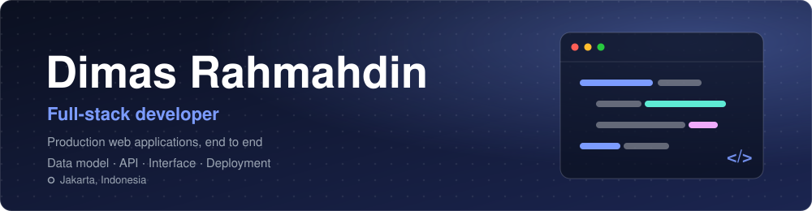
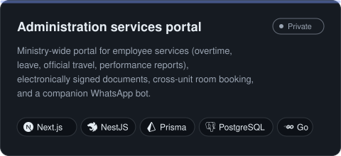
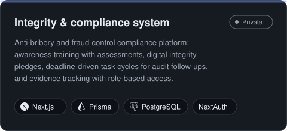
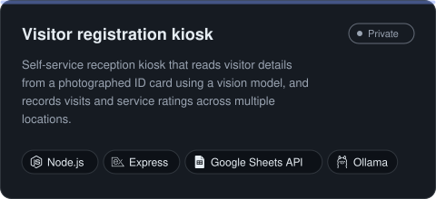
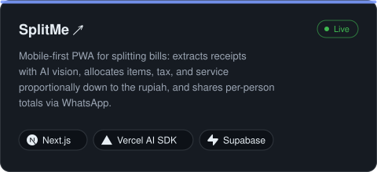
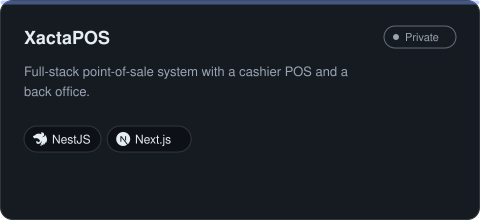
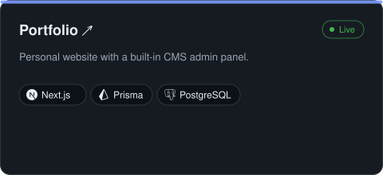
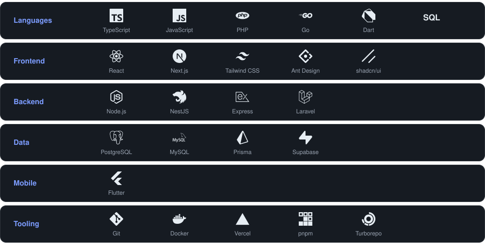
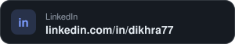

I build production web applications end to end: data model, API, interface, and deployment. Most of my recent work is internal software for an Indonesian government ministry — workflow, document, and compliance systems used daily by its staff.

## Featured work

Most of these repositories are private. I'm happy to walk through the code on request.

## Tech stack

## Contact

 
